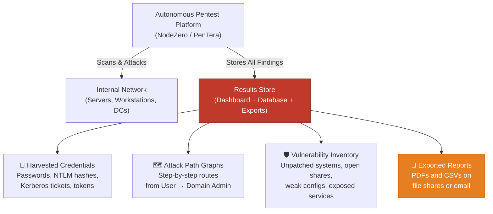

# Hacking the Hacker's Findings: Internal Risks of Autonomous Pentest Tools in AI-Monitored Networks

**Author: Divesh Gupta**
**Date: May 2026**
**Perspective: Internal Penetration Testing**

---

## Introduction

Autonomous penetration testing platforms have become a staple in enterprise security programs. Tools like Horizon3.ai's NodeZero and PenTera simulate real-world attacks across internal networks — discovering misconfigurations, harvesting credentials, and mapping complete attack paths from a standard user account to domain administrator. For blue teams, the results are gold: a prioritized list of exactly what to fix.

But those same results are gold for someone else too — a malicious insider.

Every autonomous pentest run produces a concentrated inventory of the organization's weaknesses: working credentials, unpatched hosts, exploitable services, and step-by-step lateral movement chains. If access controls around the pentest platform and its outputs are weak, an insider doesn't need to run their own attack. They just read the results.

What makes this worse is the environment these platforms operate in. Most organizations deploy AI-based security tools — UEBA (User and Entity Behavior Analytics) and NTA (Network Traffic Analysis) — to detect insider threats. But in practice, these AI tools are deliberately configured to ignore the pentest platform to avoid alert fatigue. The result: a critical blind spot exactly where the risk is highest.

This blog examines how an internal attacker can exploit autonomous pentest findings as a pre-built attack roadmap, and why AI-based monitoring typically fails to catch it.

---

## How Autonomous Pentest Platforms Work — and What They Store

An autonomous pentest platform operates with a simple premise: deploy an agent or virtual appliance inside the network, give it minimal credentials, and let it attack. The platform crawls the environment, tests exploits, collects evidence, and generates a detailed report.

The critical detail is **what gets stored** after a scan completes:



The **Results Store** (red) holds live credentials and validated attack chains. **Exported Reports** (orange) often end up on shared network drives where access controls are loose. Both are high-value targets for an insider.

---

## The Risk: Pentest Results as an Insider's Attack Playbook

From an internal pentester's perspective, the autonomous pentest platform is the single highest-value target on the network. Compromising it grants everything an attacker needs — without any of the work.

### Step 1: Discovery

The platform runs on a known internal server. Finding it is trivial:

```bash
# Scan for pentest platform web dashboards on common ports
nmap -sV -p 443,8443,8080,3000 10.0.0.0/16 --open -oG pentest_platforms.txt

# Check internal DNS for obvious naming
nslookup pentera.corp.internal
nslookup nodesero.corp.internal

# Search file shares for exported pentest reports
dir \\fileserver\security$ /s /b | findstr /i "pentest pentera nodesero"
```

In many environments, the pentest platform URL is documented in the IT security wiki — accessible to any domain user.

### Step 2: Accessing the Results

Access controls on pentest platforms are frequently weak:

- **Shared admin credentials** — one login used by the entire security team, often without MFA
- **Exported reports on file shares** — PDF and CSV exports placed on `\\fileserver\security-reports\` with broad read permissions
- **API keys stored in automation scripts** — platforms offer REST APIs, and the keys are often hardcoded in scheduled scan scripts on Jenkins or Ansible servers

### Step 3: Weaponizing the Findings

Once an insider has access, the pentest report becomes a step-by-step instruction manual. A simple script can extract the most valuable data:

```python
"""
Parse an exported pentest report CSV for credentials and critical attack paths.
An insider with access to the report share can extract a ready-made attack plan.
"""
import csv

def extract_attack_roadmap(report_path):
    credentials = []
    critical_paths = []

    with open(report_path, 'r') as f:
        reader = csv.DictReader(f)
        for row in reader:
            # Collect harvested credentials
            if row.get('finding_type') == 'credential':
                credentials.append({
                    'account': row['target_account'],
                    'hash': row['evidence'],        # NTLM hash or plaintext
                    'host': row['target_host'],
                    'privilege': row['access_level']  # admin, user, service
                })
            # Collect validated attack paths to high-value targets
            if row.get('severity') == 'critical' and 'attack_path' in row.get('category', ''):
                critical_paths.append({
                    'start': row['source_host'],
                    'end': row['target_host'],
                    'technique': row['description'],
                    'validated': True  # The platform already proved this works
                })

    print(f"[+] Found {len(credentials)} working credentials")
    print(f"[+] Found {len(critical_paths)} validated attack paths to critical assets")
    return credentials, critical_paths
```

The key difference from a traditional attack: **every finding is pre-validated**. The platform already confirmed these credentials work and these attack paths succeed. The insider skips all trial-and-error.

---

## The Blind Spot: Why AI Security Tools Miss This

Here is where the problem compounds. Organizations deploy AI-based detection (UEBA, NTA) specifically to catch insider threats — but these tools are systematically blind to pentest platform abuse.

**Whitelisting creates a gap.** During scheduled scans, the pentest platform generates massive volumes of suspicious traffic — port scans, credential testing, lateral movement. To prevent the UEBA and NTA from drowning in thousands of false-positive alerts, security teams add the pentest platform's IP addresses and service accounts to exclusion lists. These whitelists typically remain active permanently, even between scan windows. Any insider activity that touches the pentest platform falls inside this monitoring gap.

**Sparse access patterns defeat behavioral models.** UEBA builds behavioral baselines from repeated observations. If only two or three security engineers access the pentest dashboard, the model has insufficient data to establish what "normal" access looks like. An insider accessing the dashboard outside business hours may not trigger an anomaly score because the model has no confident baseline to compare against.

**Report downloads look like normal traffic.** An insider downloading a pentest report PDF from an internal web dashboard generates a standard HTTPS session. To the NTA, this looks identical to any other internal web browsing — no volume anomaly, no unusual protocol, no suspicious destination.

---

## Findings Summary

| Finding | Root Cause | How an Internal Pentest Validates It |
|---|---|---|
| Pentest platform stores live credentials and validated attack paths | By design — platforms retain evidence for reporting | Access the results dashboard and verify credential data is readable |
| Results exported to overly permissive file shares | Reports placed on shared drives without restricting read access | Enumerate file shares with a standard domain account, check for pentest report files |
| AI-based UEBA/NTA whitelists the pentest platform permanently | Exclusion added during scan window, never removed | Review UEBA exclusion list for pentest platform IPs and service accounts |
| Behavioral baseline too sparse to detect unauthorized access | Only 2–3 users access the platform — insufficient for UEBA modeling | Attempt dashboard login from an unauthorized account and verify no alert fires |

---

## Recommendations

1. **Enforce strict RBAC and MFA on the pentest platform.** Individual accounts with multi-factor authentication — no shared logins. Audit every access event. This is the single most impactful control.

2. **Eliminate exported reports on shared drives.** Keep results exclusively within the platform's own access-controlled dashboard. If exports are required, use encrypted files with time-limited access and watermarking to trace leaks.

3. **Time-box UEBA/NTA whitelists.** Automate whitelist entries to activate only during scheduled scan windows and expire immediately after. Between scans, all pentest platform traffic should be monitored normally.

4. **Force credential rotation after every pentest.** Every credential discovered by the platform should be rotated immediately after the engagement. This neutralizes the value of stolen results — the harvested passwords no longer work.

5. **Deploy a deterministic alerting rule for platform access.** Since UEBA cannot reliably baseline sparse-access systems, create a simple rule-based alert: "Notify SOC if any account other than [authorized list] accesses the pentest platform." This compensates for the AI tool's statistical blind spot with a straightforward policy check.

---

## Conclusion

Autonomous pentest platforms are powerful defensive tools, but their stored findings — validated credentials, proven attack paths, and mapped vulnerabilities — represent one of the most concentrated attack surfaces in an internal network. When AI-based detection systems are whitelisted to ignore these platforms, organizations create a blind spot precisely where insider risk is greatest. Defending the tool that maps your weaknesses deserves the same rigor as fixing the weaknesses it finds.

---

## Appendix: Methodology Notes

### Analysis Approach

1. Reviewed publicly available documentation for autonomous pentest platforms (Horizon3.ai NodeZero, PenTera) to understand data retention, export formats, and API capabilities
2. Analyzed common UEBA/NTA deployment patterns and whitelisting practices based on vendor documentation from Exabeam, Darktrace, and Microsoft Sentinel
3. Mapped the insider threat scenario to the MITRE ATT&CK framework:
   - **T1083** — File and Directory Discovery (finding exported reports on file shares)
   - **T1078** — Valid Accounts (using credentials harvested from pentest results)
   - **T1021** — Remote Services (lateral movement using discovered attack paths)
   - **T1039** — Data from Network Shared Drive (accessing pentest reports on shares)
4. Developed hardening recommendations referencing industry standards

### References

- MITRE ATT&CK Framework — Techniques T1083, T1078, T1021, T1039 — [https://attack.mitre.org/techniques/enterprise/](https://attack.mitre.org/techniques/enterprise/)
- Horizon3.ai NodeZero Documentation — [https://www.horizon3.ai/nodesero/](https://www.horizon3.ai/nodesero/)
- PenTera Platform Architecture — [https://www.pentera.io/platform/](https://www.pentera.io/platform/)
- NIST SP 800-53 Rev. 5 — Controls AC-6 (Least Privilege), AU-12 (Audit Record Generation), SI-7 (Information Integrity) — [https://csrc.nist.gov/publications/detail/sp/800-53/rev-5/final](https://csrc.nist.gov/publications/detail/sp/800-53/rev-5/final)
- CIS Controls v8 — Control 18 (Penetration Testing) — [https://www.cisecurity.org/controls/v8](https://www.cisecurity.org/controls/v8)

### AI Usage Disclosure

AI tools were used for grammar review, formatting assistance, and Mermaid diagram syntax generation. The core technical analysis, attack scenario, findings, and recommendations are the author's original work.
